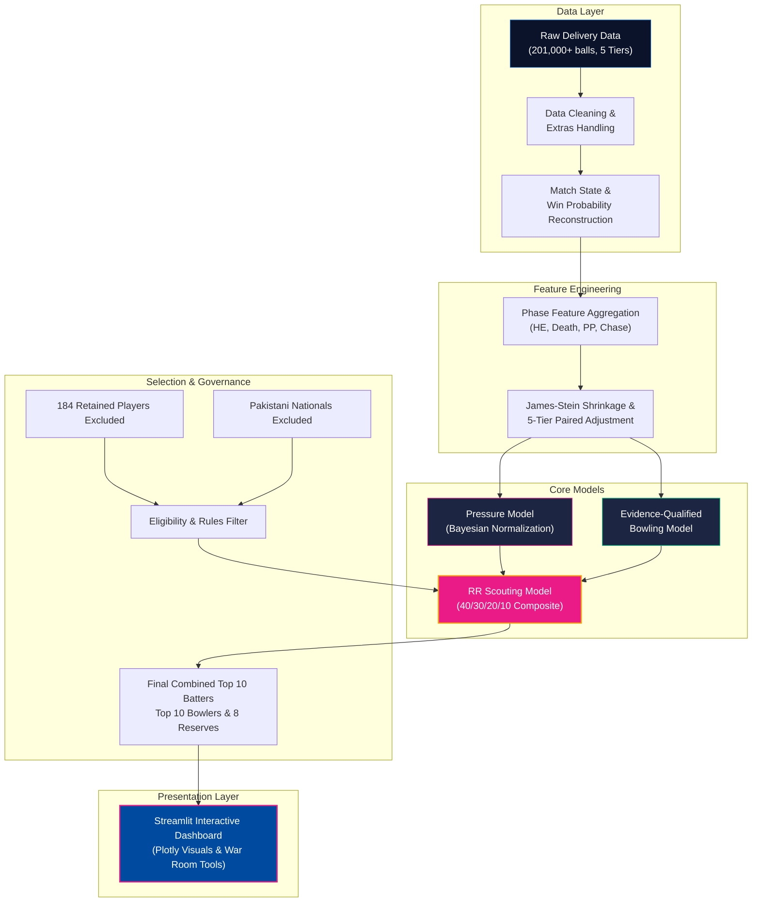

# PRESSURE-X | Rajasthan Royals IPL 2027 Auction Intelligence

[](https://www.python.org/downloads/)
[](http://localhost:8501)
[](https://plotly.com/)
[]()

> **Evidence-Based T20 Pressure Performance Modeling & Long-Term Talent Scouting Strategy for Rajasthan Royals (IPL 2027)**  
> Developed for **SupeRR Selector Season 2**.

---

## 1. Executive Summary

Traditional T20 scouting heavily over-indexes on raw aggregate strike rates, overall economy, and unadjusted boundary counts across disparate global competitions. A strike rate of 160 in a domestic developmental league does not translate to high-leverage IPL playoff encounters against express pace and elite mystery spin.

**PRESSURE-X** solves this fundamental valuation problem through:
1. **Match-Situation Win Probability Weighting:** Evaluating ball-by-ball execution strictly under leverage (High-Extreme, Death Overs 17–20, Powerplay Overs 1–6, and 2nd Inning Run Chases).
2. **Empirical Bayes Shrinkage (James-Stein):** Pulling noisy low-sample rate metrics toward global population priors to eliminate small-sample noise.
3. **Cross-Tier Competition Calibration:** Adjusting raw performances across 5 competition tiers (T1 IPL baseline down to T5 domestic) using paired empirical factors.
4. **Evidence-Qualified (EQ) Bowling Formulation:** Replacing zero-opportunity shrinkage artifacts with evidence-weighted scores and codifying strict tactical deployment boundaries.
5. **Rajasthan Royals 40/30/20/10 Talent Scouting Framework:** Combining historical pressure performance with age runway, skill ceiling, and verified 2025–2026 competitive form.

---

## 2. System Architecture



---

## 3. Official Verified Auction Shortlist

### 🏏 Top 10 Batters (Combined Indian + Overseas)

| Rank | Player | Country | Nationality | Age (2027) | Career Stage | Historical Pressure | RR Scouting Score | 2026 Form |
|:---:|:---|:---:|:---:|:---:|:---|:---:|:---:|:---:|
| **1** | **Jake Fraser-McGurk** | AUS | Overseas | 24 | Young development candidate | 92.20 | **91.88** | STRONG |
| **2** | **Jacob Bethell** | ENG | Overseas | 23 | Emerging | 87.18 | **90.27** | POSITIVE |
| **3** | **Harry Brook** | ENG | Overseas | 28 | Prime-age performer | 93.30 | **89.42** | STRONG |
| **4** | **Pathum Nissanka** | SL | Overseas | 28 | Prime-age performer | 86.07 | **81.13** | POSITIVE |
| **5** | **Shai Hope** | WI | Overseas | 33 | Experienced performer | 87.20 | **76.28** | STRONG |
| **6** | **M Shahrukh Khan** | IND | Indian | 31 | Experienced performer | 84.65 | **73.76** | POSITIVE |
| **7** | **Rilee Rossouw** | SA | Overseas | 37 | Experienced performer | 89.28 | **71.41** | POSITIVE |
| **8** | **Glenn Maxwell** | AUS | Overseas | 38 | Experienced performer | 89.04 | **70.92** | MIXED |
| **9** | **Karun Nair** | IND | Indian | 35 | Experienced performer | 88.02 | **68.41** | WEAK |
| **10** | **Vijay Shankar** | IND | Indian | 36 | Experienced performer | 85.63 | **66.85** | INSUFFICIENT DATA |

*Note on Bethell (#2) vs Brook (#3):* Harry Brook carries the higher base historical pressure score (93.30 vs 87.18), but Jacob Bethell ranks #2 overall due to his generational age runway (Age 23, Emerging category = 100 pts vs Brook Age 28 = 65 pts), unlocking an 8–10 year franchise core asset.

---

### 🎳 Top 10 Bowlers (Evidence-Qualified & Deployment Bound)

| Rank | Player | Country | Nationality | Age (2027) | Career Stage | EQ Bowling Score | RR Scouting Score | 2026 Form |
|:---:|:---|:---:|:---:|:---:|:---|:---:|:---:|:---:|
| **1** | **Mohammad Ghazanfar** | AFG | Overseas | 21 | Emerging | 70.30 | **84.52** | POSITIVE |
| **2** | **Ripon Mondol** | BAN | Overseas | 24 | Young development candidate | 78.63 | **81.95** | INSUFFICIENT DATA |
| **3** | **Mujeeb Ur Rahman** | AFG | Overseas | 26 | Young development candidate | 72.85 | **79.94** | POSITIVE |
| **4** | **Harry Tector** | IRE | Overseas | 27 | Prime-age performer | 75.71 | **76.18** | POSITIVE |
| **5** | **Matthew Forde** | WI | Overseas | 24 | Young development candidate | 68.76 | **75.80** | INSUFFICIENT DATA |
| **6** | **Ashton Agar** | AUS | Overseas | 33 | Experienced performer | 84.10 | **74.04** | POSITIVE |
| **7** | **Benjamin Sears** | NZ | Overseas | 29 | Prime-age performer | 71.14 | **73.26** | MIXED |
| **8** | **Michael Bracewell** | NZ | Overseas | 36 | Experienced performer | 82.69 | **69.48** | POSITIVE |
| **9** | **Sikandar Raza** | ZIM | Overseas | 40 | Experienced performer | 72.88 | **65.95** | STRONG |
| **10** | **Simarjeet Singh** | IND | Indian | 29 | Prime-age performer | 59.69 | **65.68** | MIXED |

#### 🚨 Codified Bowler Deployment Boundaries
- **Mohammad Ghazanfar (Rank 1):** Middle Overs Specialist (Overs 7–15). **Strict Prohibition:** Prohibited from death-phase and powerplay bowling in Year 1 due to 0 observed high-extreme deliveries.
- **Ripon Mondol (Rank 2):** Death-overs asset (54 observed death balls in dataset); developed under Shane Bond as high-pace death executioner.
- **Michael Bracewell (Rank 8):** Powerplay & middle matchup off-spinner vs LHB. **Strict Prohibition:** Zero death overs bowled; banned from death-overs assignment.
- **Harry Tector (Rank 4):** Matchup off-spin; prohibited from frontline death overs.

---

## 4. Rajasthan Royals Talent Scouting Model Formulation

The final ranking is determined by the multi-criteria optimization formula:

$$\text{RR Scouting Priority} = 0.40 \cdot S_{\text{Pressure}} + 0.30 \cdot S_{\text{Age/Dev}} + 0.20 \cdot S_{\text{Ceiling}} + 0.10 \cdot S_{\text{Form}}$$

Where:
- **$S_{\text{Pressure}}$ (40%):** Validated historical Bayesian pressure score (or Evidence-Qualified bowling score).
- **$S_{\text{Age/Dev}}$ (30%):** Development runway benchmark calculated as of **1 April 2027**:
  - Emerging ($\le 23$ yrs): **100 pts** (8–10+ year runway)
  - Young Development Candidate (24–26 yrs): **85 pts** (6–8 year runway)
  - Prime-Age Performer (27–30 yrs): **65 pts** (3–5 year peak window)
  - Experienced Tactical Asset ($\ge 31$ yrs): **50 pts** (Immediate 1–2 year impact)
- **$S_{\text{Ceiling}}$ (20%):** Composite technical ceiling, athletic fielding, bat speed, mystery variation, and tactical squad fit.
- **$S_{\text{Form}}$ (10%):** Audited 2025–2026 match logs across domestic and international leagues.

---

## 5. Interactive Scouting Dashboard

The project includes an interactive **Streamlit + Plotly** scouting application designed for franchise executives, analysts, and coaching staff.

### Features
- **Page 1 — Executive Overview:** High-level KPIs, qualification funnel, roster composition, and CSV downloads.
- **Page 2 — Top 10 Batters:** Interactive filtering, horizontal score breakdown, age runway vs scouting, and player spotlight cards.
- **Page 3 — Top 10 Bowlers:** Evidence-qualified bowler tables, phase delivery distribution, and codified tactical boundaries.
- **Page 4 — Player Comparison:** Side-by-side 5-dimension radar charts and comparative metric tables.
- **Page 5 — RR Long-Term Strategy:** Age distributions, development runways, and reserve roster reviews.
- **Page 6 — Methodology & Reliability:** Mathematical formulas, shrinkage parameters, and data boundary disclosures.

---

## 6. Quick Start & Execution Guide

### Prerequisites
- Python 3.9+ (Python 3.10/3.11 recommended)
- Virtual environment recommended

### Installation

```bash
# 1. Clone repository
git clone https://github.com/kapi31jangid/SupeRR-Selector-2027.git
cd SupeRR-Selector-2027

# 2. Install dependencies
pip install -r requirements.txt
```

### Launch Interactive Dashboard

```bash
# Run Streamlit dashboard locally
streamlit run app.py
```
*Access the local web dashboard at `http://localhost:8501`.*

### Run End-to-End Verification Pipeline

```bash
# Execute automated data validation and model initialization
python src/pipeline.py
```

---

## 7. Project Directory Structure

```
SupeRR-Selector-2027/
├── app.py                             ← Streamlit Interactive Scouting Dashboard
├── README.md                          ← Project Documentation & Landing Page
├── DATA_DICTIONARY.md                 ← Complete Dataset Field Specifications
├── requirements.txt                   ← Dependencies (pandas, numpy, scipy, streamlit, plotly)
├── .gitignore                         ← Virtualenv and cache exclusions
│
├── data/
│   ├── raw/                           ← Immutable challenge source data (ball_by_ball, matches, etc.)
│   └── processed/                     ← Cleaned, phase-annotated feature tables across 5 tiers
│
├── models/
│   ├── pressure_model.py              ← Bayesian shrinkage & competition tier scoring
│   ├── bowling_eq_model.py            ← Evidence-Qualified bowling & tactical boundaries
│   └── rr_scouting_model.py           ← 40/30/20/10 RR Scouting Composite Engine
│
├── src/
│   ├── data_cleaning/                 ← Delivery filtering & player identity normalization
│   ├── preprocessing/                 ← Match state reconstruction & competition tiers
│   ├── feature_engineering/           ← Phase feature aggregation & James-Stein shrinkage
│   ├── utilities/                     ← Automated data validator & relative path resolution
│   └── pipeline.py                    ← End-to-end execution runner
│
├── outputs/
│   ├── final_combined_top10_batters.csv   ← FINAL VERIFIED BATTER TARGETS
│   ├── final_combined_top10_bowlers.csv   ← FINAL VERIFIED BOWLER TARGETS
│   ├── final_combined_reserves.csv        ← Key reserve candidates
│   └── supporting_evidence/               ← 16 forensic audit CSVs & markdown proofs
│
├── dashboard/
│   ├── components/                    ← KPI cards, player profiles, styled tables
│   ├── charts/                        ← Plotly bar charts, scatter plots, radar charts
│   └── utils/                         ← Cached data loaders & RR color palette
│
├── reports/
│   ├── FINAL_SUBMISSION_REPORT.md     ← Comprehensive submission playbook
│   ├── METHODOLOGY.md                 ← Mathematical formulation & shrinkage equations
│   ├── VALIDATION_AND_LIMITATIONS.md  ← Audit findings, ID corrections & caveats
│   ├── RR_SCOUTING_STRATEGY.md        ← Franchise talent development philosophy
│   ├── FINAL_SUBMISSION_AUDIT.md      ← Pre-submission verification audit
│   └── FINAL_PROJECT_STRUCTURE_AUDIT.md ← Final acceptance engineering audit
│
└── assets/
    └── dashboard_visuals/             ← Visual assets and charts
```

---

## 8. Deployment Guide (Streamlit Community Cloud)

To deploy the dashboard publicly on Streamlit Community Cloud:

1. **Push to GitHub:**
   Ensure the repository is pushed to GitHub with `app.py` in the root directory.
2. **Connect Streamlit Community Cloud:**
   - Sign in at [share.streamlit.io](https://share.streamlit.io/).
   - Click **New app**.
   - Select repository: `SupeRR-Selector-2027`.
   - Branch: `master` (or `main`).
   - Main file path: `app.py`.
3. **Deploy:**
   Click **Deploy!**. Streamlit automatically resolves dependencies from `requirements.txt`.

*Deployment Status:* The application runs locally via `streamlit run app.py` and is fully configured for zero-configuration deployment to Streamlit Community Cloud.

---

## 9. Methodological Limitations & Integrity Declarations

- **Unobserved Bowling Phases:** Bowlers with 0 observed deliveries in specific pressure phases (e.g. Ghazanfar, Bracewell) are evaluated using Evidence-Qualified scoring across observed phases only; unobserved phases are never treated as proven capability.
- **Sample Size Restrictions:** A strict threshold of $\ge 100$ qualifying balls faced or bowled was enforced to prevent small-sample bias.
- **Auction Eligibility Filters:** All 184 retained players across the 10 IPL franchises and all Pakistani nationals were strictly excluded in compliance with BCCI regulations.
- **Challenge Scope:** PRESSURE-X was developed independently for the SupeRR Selector Season 2 competition and represents a proposed analytical scouting framework.

---

*PRESSURE-X | SupeRR Selector Season 2 | Rajasthan Royals IPL 2027 Auction Strategy Group*
